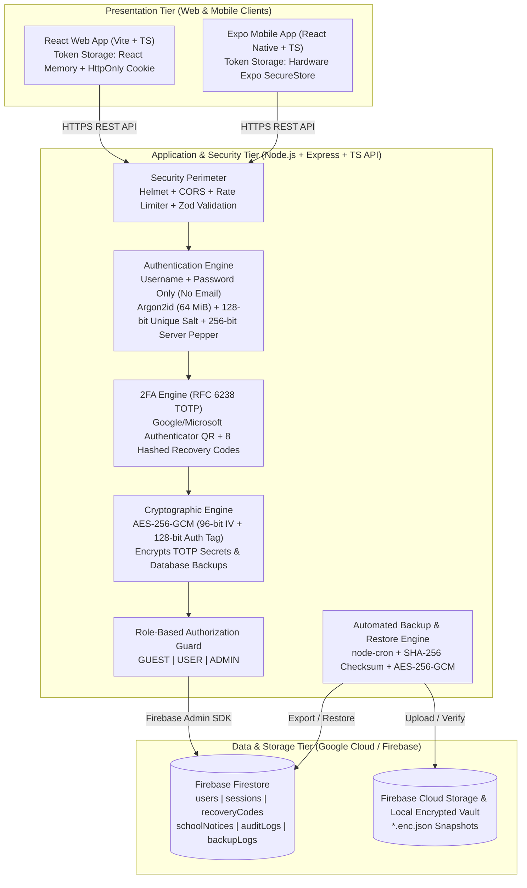

# 🎓 NKETIAH School Management System
**Secure Role-Based Authentication System with Two-Factor Authentication (2FA), Cryptographic Protection, and Automated Database Backups**

---

## 1. System Overview & Objective
The **NKETIAH School Management System** is a full-stack academic cybersecurity platform consisting of:
1. **Central Node.js + TypeScript + Express REST API (`backend/`)** — The sole security, authentication, authorization, and cryptographic authority.
2. **React + TypeScript + Vite + Tailwind CSS Web Portal (`web/`)** — Responsive web interface for `GUEST`, `USER` (Student/Staff), and `ADMIN` roles.
3. **React Native + Expo + TypeScript Mobile App (`mobile/`)** — Cross-platform mobile app sharing the exact same Node.js API and storing tokens in hardware-backed `expo-secure-store`.
4. **Google Cloud / Firebase Firestore & Cloud Storage** — Online document database locked down via Zero-Trust Firestore Security Rules (`allow read, write: if false;`), accessed exclusively by the Node.js backend via the **Firebase Admin SDK**, with **Automated AES-256-GCM Encrypted Backups & One-Click Restoration**.

---

## 2. System Architecture Diagram



---

## 3. Firestore Database Structure (6 Collections)

1. **`users` Collection**
   - Document ID: `usr_<uuid>` (Internal identifier; **never** required for login)
   - Fields: `username`, `usernameNormalized` (indexed lowercase for uniqueness), `fullName`, `department`, `studentOrStaffId`, `role` (`USER` | `ADMIN`), `status` (`ACTIVE` | `DISABLED`), `passwordHash` (Argon2id string containing parameters + unique 16-byte salt), `twoFactorEnabled`, `totpSecretEncrypted` (`{ algorithm: 'aes-256-gcm', ivHex, authTagHex, ciphertextHex }`), `pendingTotpSecretEncrypted`, `failedLoginAttempts`, `lockoutUntil`, `lastLoginAt`, `createdAt`, `updatedAt`.
2. **`sessions` Collection**
   - Document ID: `ses_<uuid>`
   - Fields: `userId`, `username`, `refreshTokenHash` (SHA-256 hash of opaque token), `ipAddress`, `userAgent`, `revoked`, `expiresAt`, `createdAt`, `rotatedAt`.
3. **`recoveryCodes` Collection**
   - Document ID: Matches `userId`
   - Fields: `userId`, `codes` (Array of `{ codeHash, used, usedAt }` hashed with HMAC-SHA256 + Server Pepper), `generatedAt`.
4. **`schoolNotices` Collection**
   - Document ID: `ntc_<uuid>`
   - Fields: `title`, `category` (`ACADEMIC` | `SECURITY` | `ADMISSIONS` | `EXAMINATIONS` | `GENERAL`), `content`, `visibility` (`PUBLIC` | `AUTHENTICATED_ONLY` | `ADMIN_ONLY`), `authorUsername`, `authorRole`, `createdAt`, `updatedAt`.
5. **`auditLogs` Collection**
   - Document ID: `aud_<timestamp>_<random>`
   - Fields: `eventType`, `severity` (`INFO` | `WARNING` | `CRITICAL`), `actorUserId`, `actorUsername`, `targetUserId`, `targetUsername`, `ipAddress`, `userAgent`, `details`, `metadata`, `createdAt`.
6. **`backupLogs` Collection**
   - Document ID: `bkp_<timestamp>_<random>`
   - Fields: `backupId`, `filename`, `triggerType` (`AUTOMATED_CRON` | `MANUAL_CLI` | `ADMIN_API`), `status` (`SUCCESS` | `FAILED` | `RESTORED`), `storageLocation`, `sizeBytes`, `checksumSha256`, `encryptionAlgorithm` (`aes-256-gcm`), `collectionCounts`, `triggeredByUsername`, `createdAt`, `restoredAt`.

---

## 4. Core Security Flows

### A. Registration & Password Hashing Flow (`Argon2id + Salt + Pepper`)
```text
Plaintext Password + Server-Side Pepper (.env)
        ↓ [HMAC-SHA256]
Peppered Password Digest + Unique 16-Byte Cryptographic Salt (crypto.randomBytes(16))
        ↓ [Argon2id: 64 MiB RAM, 3 Iterations, 4 Parallelism]
Encoded Hash ($argon2id$v=19$m=65536,t=3,p=4$<salt>$<hash>) → Stored in Firestore `users`
```

### B. Authentication & Two-Factor Authentication (2FA) Flow
```text
Step 1: Client submits { username, password } to POST /api/auth/login
        ↓
Step 2: Server verifies Argon2id hash with Server Pepper
        ├─ If 2FA is OFF → Issues 15m Access JWT + 7d Refresh Token
        └─ If 2FA is ON  → Issues 5m `preAuthToken` (scoped strictly to /api/auth/verify-2fa)
                ↓
Step 3: Client submits { preAuthToken, code } to POST /api/auth/verify-2fa
        ↓
Step 4: Server decrypts `totpSecretEncrypted` using AES-256-GCM in RAM (or checks Recovery Code hash)
        ↓
Step 5: Verifies RFC 6238 6-digit TOTP code → Issues 15m Access JWT + 7d Refresh Token
```

### C. AES-256-GCM Encryption Flow (TOTP Secrets & Backups)
```text
Plaintext (Base32 TOTP Secret OR Full Firestore JSON Backup)
        + 256-bit Master Key (env.AES_256_GCM_KEY_HEX)
        + Fresh 96-bit Random IV/Nonce (crypto.randomBytes(12))
        ↓ [AES-256-GCM Cipher]
Outputs: { ivHex (24 hex chars), authTagHex (32 hex chars / 128-bit MAC), ciphertextHex }
```

### D. Automated Backup & Restoration Flow
1. **Backup Creation (`node-cron` / `npm run backup` / Admin UI):**
   - Exports all Firestore collections (`users`, `sessions`, `recoveryCodes`, `schoolNotices`, `auditLogs`).
   - Computes a **SHA-256 integrity checksum** of the snapshot.
   - Encrypts the entire snapshot with **AES-256-GCM**.
   - Uploads to **Firebase Cloud Storage (`gs://...`)** and saves a local copy in `backend/backups/*.enc.json`.
2. **Database Restoration (`npm run restore` / Admin UI):**
   - Reads the encrypted `.enc.json` backup archive.
   - Verifies the **128-bit AES-256-GCM Authentication Tag** during decryption.
   - Verifies the **SHA-256 Checksum** matches the decrypted JSON.
   - Restores all collections into Firestore and records a `DATABASE_RESTORED` audit log.

---

## 5. How to Run, Test & Demonstrate the Project

### Default Seeded Demo Accounts
| Role | Username | Password |
| :--- | :--- | :--- |
| **ADMIN** | `nketiah_admin` | `Admin@Nketiah2026!` |
| **USER (Student)** | `kwame_student` | `Student@Nketiah2026!` |

### 1. Run Automated Security & API Tests (Vitest + Supertest)
```powershell
cd backend
npm.cmd test
```

### 2. Trigger Manual Encrypted Backup & Restore via CLI
```powershell
cd backend
npm.cmd run backup
npm.cmd run restore
```

### 3. Start the Central Node.js Security API (Port 4000)
```powershell
cd backend
npm.cmd run dev
```

### 4. Start the React Web Application (Port 5173)
```powershell
cd web
npm.cmd run dev
```
Open **`http://localhost:5173`** in your browser.

### 5. Start the Expo Mobile Application
```powershell
cd mobile
npm.cmd install
npx.cmd expo start
```

---

## 6. Lecturer Defense Q&A Preparation (All 21 Questions Answered)

1. **“What is authentication?”**
   - Authentication answers *“Who are you?”* It is the process of verifying a user's claimed identity—in our NKETIAH system, using their unique **Username**, **Password**, and **TOTP 2FA code**.
2. **“What is authorization?”**
   - Authorization answers *“What are you allowed to do?”* After authentication succeeds, our Role-Based Access Control (RBAC) middleware checks whether the user is a `GUEST`, `USER`, or `ADMIN` before allowing access to protected routes.
3. **“What is a salt?”**
   - A salt is a unique, cryptographically random 128-bit (16-byte) value generated for each password and stored alongside the hash. It ensures that two users with the exact same password produce completely different hashes and defeats precomputed Rainbow Table attacks.
4. **“What is a pepper?”**
   - A pepper is an additional 256-bit cryptographic secret applied to every password via `HMAC-SHA256` before Argon2id hashing. Unlike the salt, the pepper is **never** stored in the Firestore database.
5. **“Where is your pepper stored?”**
   - Strictly in the server's environment variables (`backend/.env` as `PASSWORD_PEPPER` during development, and Google Cloud Secret Manager in production), completely separate from Firestore.
6. **“Why did you use Argon2id?”**
   - Argon2id won the Password Hashing Competition and is the #1 OWASP recommendation. It is a hybrid algorithm combining **Argon2i** (resistance against side-channel timing attacks) and **Argon2d** (memory-hard resistance—64 MiB RAM per hash—against GPU/ASIC cracking hardware).
7. **“Why are passwords hashed instead of encrypted?”**
   - Encryption is two-way (reversible with a key). If an attacker stole the encryption key, they could decrypt every user's password in milliseconds. Hashing is a **one-way function**—the server never needs to know the original password, only whether the login input produces the same hash.
8. **“What cryptographic technique did you implement?”**
   - **AES-256-GCM** (Advanced Encryption Standard with a 256-bit symmetric key in Galois/Counter Mode) to encrypt users' **TOTP 2FA secrets** and **automated database backup archives**.
9. **“Why AES-256-GCM?”**
   - Unlike password verification, TOTP verification requires the server to know the shared Base32 secret to compute `HMAC-SHA1(secret, timeStep)`. Thus, the secret must be reversibly encrypted. AES-256-GCM provides both **Confidentiality** (256-bit encryption) and **Integrity/Authenticity** (via a 96-bit unique IV and a 128-bit Authentication Tag that detects any tampering).
10. **“What is TOTP?”**
    - **Time-Based One-Time Password (RFC 6238)**. It computes a 6-digit code that changes every 30 seconds using `HMAC-SHA1` over a shared secret and the current Unix timestamp divided by 30.
11. **“How does 2FA work in your project?”**
    - During setup, the backend generates a 160-bit Base32 secret, encrypts it with AES-256-GCM, and renders a QR code for Google/Microsoft Authenticator. Once the user verifies a 6-digit code, 2FA is enabled and 8 one-time recovery codes (stored as HMAC-SHA256 hashes) are issued. During login, after password verification, the server issues a 5-minute `preAuthToken` and only issues an Access JWT after the 6-digit TOTP (or recovery code) is verified.
12. **“How does the mobile application communicate with the backend?”**
    - The Expo React Native app communicates over HTTPS with the exact same Node.js REST API (`/api/*`) as the React Web app, sending its short-lived Access JWT in the `Authorization: Bearer <token>` header and storing tokens in hardware-backed `expo-secure-store`.
13. **“Why did you use Node.js?”**
    - Node.js allows us to maintain a single, centralized security authority in TypeScript with native C++ bindings for `crypto` (AES-256-GCM) and `argon2` (Argon2id), serving both Web and Mobile clients from one unified API.
14. **“Why did you use Expo?”**
    - Expo allows us to build a cross-platform iOS/Android mobile app in TypeScript sharing data models with our web app while providing `expo-secure-store` for hardware-backed Keychain/Keystore token storage.
15. **“Why did you choose Firebase?”**
    - Firebase provides **Cloud Firestore** (a managed, scalable Google Cloud document database) and **Firebase Cloud Storage** (backed by Google Cloud Storage buckets) with official `firebase-admin` server SDK support.
16. **“What is Firestore?”**
    - Google Cloud's serverless NoSQL document database that organizes data into **Collections** containing **Documents** identified by unique **Document IDs**.
17. **“What happens if the database is deleted?”**
    - An Administrator can run `npm run restore` or click **"Restore Database from Snapshot"** in the Admin Dashboard. The system reads the latest AES-256-GCM encrypted backup file, verifies its 128-bit GCM Authentication Tag and SHA-256 checksum, and restores all collections.
18. **“How does your automatic backup work?”**
    - `node-cron` runs on a scheduled interval (`0 */6 * * *`), exports all Firestore collections, computes a SHA-256 checksum, encrypts the JSON snapshot with AES-256-GCM, writes the `.enc.json` archive to Firebase Cloud Storage and the local encrypted vault (`backend/backups/`), and logs the result in `backupLogs` and `auditLogs`.
19. **“How do you restore the database?”**
    - Via `POST /api/admin/backups/:backupId/restore` (in the Admin UI) or `npm run restore` (CLI). It decrypts the AES-256-GCM payload, verifies the SHA-256 checksum, and batch-writes all documents back into Firestore.
20. **“What happens if someone steals the database?”**
    - Passwords cannot be cracked because they are hashed with **Argon2id + unique salts + a Server-Side Pepper** stored outside Firestore. TOTP 2FA secrets cannot be read because they are encrypted with **AES-256-GCM** whose 256-bit key is stored outside Firestore. Recovery codes and refresh tokens are stored only as one-way SHA-256/HMAC hashes.
21. **“How do you stop a normal user from accessing admin functionality?”**
    - Every `/api/admin/*` route is protected on the Node.js backend by `requireAuth` followed by `requireRole('ADMIN')`. Even if a student bypasses the React/Expo UI and calls the API directly using Postman or cURL, the backend rejects the request with `HTTP 403 Forbidden` and records an `UNAUTHORIZED_ACCESS_ATTEMPT` in `auditLogs`.
